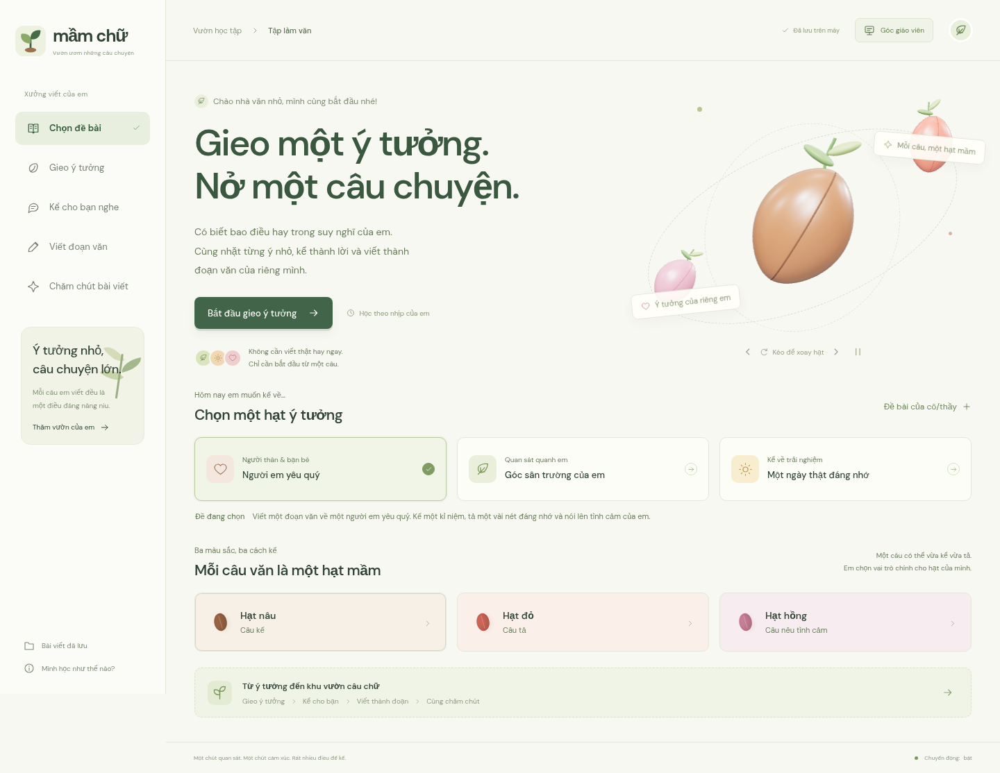

# Mầm chữ — Mỗi câu văn, một hạt mầm

Web tập viết tiếng Việt cho học sinh tiểu học, phát triển trực tiếp từ mã nguồn `nike-motion-store` bằng Vite, Three.js và GSAP. Học liệu minh họa tự biên soạn, thiết kế cho lớp 3–5; giáo viên chỉnh đề, câu hỏi và từ gợi ý cho lớp mình.



## Mở trên Windows

1. Cài Node.js **22.12 trở lên** nếu máy chưa có.
2. Giải nén ZIP, mở thư mục `web`.
3. Nhấp đúp **`CHAY-WEB.cmd`**. Tệp này dùng `npm.cmd`, cài thư viện nếu cần rồi mở trình duyệt.
4. Giữ cửa sổ chạy web mở khi học. Đóng cửa sổ hoặc nhấn Ctrl+C sẽ dừng server.

Launcher Windows được soạn để tránh lỗi chặn `npm.ps1`; chưa được chạy trên Windows trong môi trường Linux này. Nếu dùng VS Code: chuột phải **thư mục `web` → Open in Integrated Terminal**, chạy lần lượt:

```powershell
npm.cmd ci
npm.cmd run dev -- --open
```

Nếu cache npm bị từ chối quyền truy cập:

```powershell
npm.cmd ci --cache "$env:LOCALAPPDATA\mam-chu-npm-cache"
```

Chỉ chạy `dev` sau khi cài thư viện thành công. Trình duyệt mở địa chỉ terminal hiển thị, thường là `http://localhost:5173/`. Mã nguồn Vite cần server này; không mở `index.html` trực tiếp bằng Live Server.

Linux/macOS, từ thư mục `web`:

```bash
npm ci
npm run dev
```

Trong môi trường Codex hiện tại có thể dùng cache ghi được: `npm ci --cache /tmp/nike-npm-cache`.

## Hành trình học tập

1. **Chọn đề:** ba chủ đề minh họa hoặc đề riêng của giáo viên. Góc giáo viên tạo bộ câu hỏi theo chủ đề và cho sửa từng câu, loại hạt, từ gợi ý. Câu hỏi dùng mẫu cục bộ, không phải mô hình AI sinh nội dung tự do.
2. **Gieo ý tưởng:** học sinh trả lời câu hỏi và tự chọn vai trò chính cho mỗi câu. Mỗi câu được lưu thành đúng một hạt; nhập nhiều câu tạo nhiều hạt. Hạt **nâu = câu kể**, **đỏ = câu tả**, **hồng = câu nêu tình cảm**. Có gợi ý từ, sửa hạt, xóa/hoàn tác, kéo thả và nút đổi thứ tự.
3. **Kể cho bạn nghe:** thẻ câu làm gợi nhớ; carousel ba vai người kể, người nghe, người góp ý; đồng hồ một phút có dừng/đặt lại; hai ô phản hồi lịch sự. Có thể tự tập nói. Nút đọc tiếng Việt chỉ hoạt động khi thiết bị có giọng `vi` trong SpeechSynthesis, nếu thiếu sẽ thông báo rõ.
4. **Viết đoạn:** ghép các câu theo thứ tự, tự chỉnh sửa, đếm tiếng/câu, nghe lại, tải văn bản. Ghép lại khi đã sửa đoạn sẽ hỏi trước để giữ bài học sinh.
5. **Chăm chút:** nhận xét có dẫn chứng lấy từ chính bài viết, các chỗ cần xem lại và bài tập tương ứng. Học sinh thử trả lời, nhận phản hồi, rồi tự chọn áp dụng phần sửa. Bài gốc được giữ trong lịch sử sửa, có hoàn tác.
6. **Vườn của em:** thẻ câu treo giữa phong cảnh, huy hiệu theo hoạt động thực sự đã hoàn thành, đọc và tải bài viết. Không xếp hạng học sinh.

## Phạm vi kiểm tra văn

Phần kiểm tra chạy hoàn toàn trên thiết bị bằng quy tắc có thể giải thích:

- Viết hoa đầu câu, thiếu dấu kết thúc câu.
- Khoảng trắng thừa, khoảng trắng trước/sau dấu câu.
- Từ gõ lặp thuộc một số nhóm thường gặp, phân biệt với từ láy/lặp có thể hợp lệ như “xanh xanh”.
- Một danh sách cụm từ dễ viết sai, ví dụ `xinh sắn → xinh xắn`, `sạch xẽ → sạch sẽ`, `chăm trỉ → chăm chỉ`.
- Gợi ý tách câu dài, thêm chi tiết hoặc cảm xúc được ghi rõ là **gợi ý mở rộng**, không chấm thành lỗi.

Đây **không phải bộ kiểm tra ngữ pháp/chính tả tiếng Việt toàn diện**, không đọc hiểu sâu, không chấm điểm tự động và không thay thế nhận xét của giáo viên. Có thể bỏ sót lỗi hoặc nhận định chưa phù hợp ngữ cảnh. Học sinh và giáo viên quyết định phần sửa. Không có API AI hoặc yêu cầu API key trong bản này.

Bài tập lấy đúng đoạn sai và quy tắc từ bài hiện tại. Sửa một chỗ chỉ thay đúng phạm vi ấy. Nếu đoạn văn thay đổi sau khi phân tích, kết quả cũ không được áp dụng để tránh ghi đè nhầm. Mỗi lượt ưu tiên tối đa ba chỗ; sửa xong mới hiện tiếp.

## Lưu và chuyển bài

- Đề, câu hỏi, câu trả lời đang gõ, hạt, đoạn văn, góp ý và lịch sử sửa lưu trong **localStorage của trình duyệt/thiết bị đang dùng**.
- Đổi đề giữ bài của đề cũ. Không có đồng bộ giữa thiết bị, tài khoản học sinh hoặc máy chủ lớp học.
- **Bài viết đã lưu → Tải bài đang học (.json)** để sao lưu/chuyển máy; **Mở bài từ máy** để nhập lại, giữ cả các bài đang có.
- Tệp `.txt` dùng để đọc/in, tệp `.json` dùng để mở lại trong Mầm chữ. Xóa dữ liệu trình duyệt có thể làm mất bản lưu tại máy, nên tải bản sao lưu khi cần.
- Chưa có tính năng giáo viên xem từ xa kết quả cả lớp. Không gửi bài của học sinh ra mạng trong luồng học.

## Giữ nguyên mã nguồn và hiệu ứng ban đầu

**Bản gốc được giữ nguyên tại `/original.html`**, truy cập qua *Mình học như thế nào? → Phòng trải nghiệm hiệu ứng gốc*. Cả hai trang được build cùng nhau.

Các tệp `src/main.js`, `src/scene.js`, `src/style.css`, `src/data.js` và toàn bộ hình ảnh, GLB, Draco ban đầu được giữ nguyên. Hướng dẫn bản gốc ở [README-original.md](README-original.md), nguồn tài nguyên ở [ASSETS.md](ASSETS.md).

Bản học tập sử dụng tiếp các cơ chế của mã gốc:

| Hiệu ứng gốc | Trong Mầm chữ |
| --- | --- |
| WebGL, ánh sáng môi trường, raycast, pointer capture | `SeedScene extends ShoeScene`, ba hạt 3D dựng bằng hình học thực |
| Kéo/xoay, nút xoay, nổi nhẹ, tạm dừng, reduced motion | Dùng lại từ scene gốc cho hạt; vẫn đầy đủ trong bản gốc |
| Carousel phối cảnh, đổi vị trí/phóng chủ thể bằng GSAP | Carousel ba loại hạt và tập trung hạt ở trang gieo ý |
| Chuyển cảnh và stagger | Chuyển bước, thẻ hạt mới, thẻ câu trên dây |
| Quần áo treo trên nền núi, hover xoay 3D | Câu văn treo trên dây trong Vườn của em; cảnh quần áo vẫn nguyên ở bản gốc |
| Lookbook phối cảnh, hotspot, điều khiển trước/sau | Ba nhân vật nói–nghe–góp ý có hotspot; lookbook gốc vẫn nguyên |
| Panel và dialog, trạng thái lưu cục bộ | Góc giáo viên, bài đã lưu, xem hạt, chỉnh câu, xác nhận ghép bài |

Cấu trúc mới ở `src/learning/`, không viết đè ứng dụng gốc. Trang học hỗ trợ hình hạt tĩnh khi WebGL không khả dụng, vẫn giữ đầy đủ chức năng học tập.

## Build và kiểm thử

```bash
npm run test:unit
npm test
npm run build
npm run preview
```

- `tests-unit/writing.test.js`: tách câu, ba loại hạt, nhận diện lỗi, bài tập, sửa có phạm vi, kiểm tra kết quả cũ, xuất/nhập.
- `tests/learning.spec.js`: các luồng học, đề riêng, lưu bài, luyện sửa, điện thoại, reduced motion, lỗi lưu và không có WebGL.
- `tests/experience.spec.js`: toàn bộ kiểm thử ứng dụng gốc, chạy tại `/original.html`.

Playwright dùng `/usr/bin/chromium` nếu có. Trên máy khác, cài trình duyệt bằng `npx playwright install chromium` hoặc đặt `CHROMIUM_PATH`. Không cần Playwright để học hay chạy `npm run dev`.

Build gồm `dist/index.html` và `dist/original.html`. Phục vụ `dist/` bằng HTTP server tại đường dẫn gốc của website.
